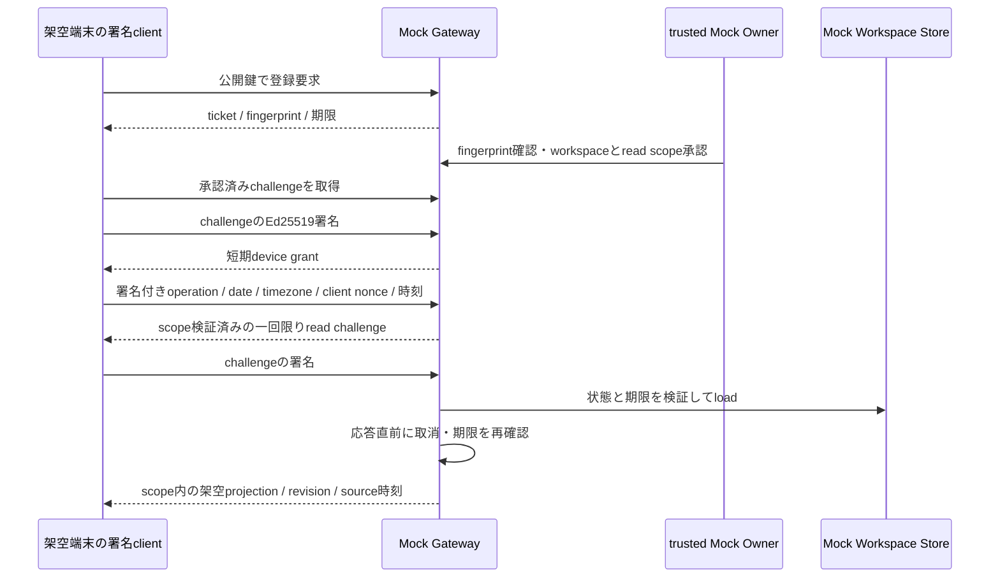

# V3 alpha.2 — Offline Mock Gateway Protocol

2026-10-11。実装: `server/v3/mock-gateway.mjs`, `gateway-contract.mjs`。JSON型: `src/v3/gateway-contracts.ts`。**実iPhone認証・TLS・実Ownerログインではない。**

## 信頼境界

`createMockGateway({ fixtureOnly: true, workspaceIds, store, now })` が、device側 `client` とtrustedなfixture `owners` を別に返す。workspace IDは `fixture-*` に限定する。Owner portはharnessだけが保持する。device requestからOwner/workspace/scopeを指定して権限を作るAPIはない。コード実行権限やhost上の攻撃者を隔離するサンドボックスとしては扱わない。

製品の `server/index.mjs` へ新しいrouteを追加していない。現在のlocalhost API、browser cookie、CORS、network exposureをこのMockへ転用しない。

## 登録

1. fixture clientがephemeral Ed25519鍵を生成する。Gatewayが受け取るのはSPKI DER公開鍵のcanonical base64urlのみ。秘密鍵はGateway、backup、receiptへ含めない。
2. `requestPairing({publicKey,label})` はpending ticketを作る。labelや表示名は認証根拠にしない。
3. `owners.get(fixtureId).approvePairing({ticketId,fingerprint,scopes})` がOwner側workspaceを束縛する。これは認証済みOwner UIの代替Mockで、製品では独立した認証と確認画面が必要。
4. `pairingChallenge(ticketId)` のpurpose、runtime issuer、ticket、nonce、公開鍵fingerprint、workspace、device ID、scope、期限の全体を署名する。
5. `completePairing({ticketId,signature})` が公開鍵で検証する。承認済み試行は成功・失敗とも一回で消費する。別鍵、workspace/scope/issuer改変、未承認、期限切れは拒否。

ticketは2分、grantは15分。ここで証明するのは登録鍵の所持とMock Ownerの承認であり、現実の人物やiPhone所有権を自動判定するものではない。

## 読み取り

`beginRead({deviceId,operation,date,timeZone,clientNonce,issuedAt,signature})` と `completeRead({requestId,signature})` の二段階。署名messageは `proofBytes()` のsorted JSON UTF-8。現在はMock専用purposeで、実HTTPのURL/body/host認証に流用しない。

challenge発行前に `readInitMessage()` の署名を確認する。messageは `today.mock.read-init.v1`、登録結果のruntime issuer、device ID、operation、date/timezone、32byte client nonce、issuedAtを束縛する。30秒を過ぎたものと5秒より未来の時刻を拒否。accepted nonceは一回だけ使用できる。無署名・別鍵・改変された要求はread枠やdevice quotaを消費しない。この検証は端末IDだけで枠を埋められる問題の再現後に追加した。

| operation  | 必要scope                                       | 応答内容                               |
| ---------- | ----------------------------------------------- | -------------------------------------- |
| `overview` | `brief:read`, `tasks:read`, `agenda:read`の全て | selected-only DailyOverview            |
| `tasks`    | `tasks:read`                                    | task一覧と最小source/revision metadata |
| `agenda`   | `agenda:read`                                   | event一覧とcalendar freshness          |

任意URL、write operation、caller-selected workspace、余分なfield、不正暦日/timezoneは拒否する。read challengeは30秒で、一度の署名検証試行で消費する。device IDだけを知ってもデータを取得できない。runtime再作成時はissuerと全grant/challengeを新しくし、以前の要求を受け付けない。

`revokeDevice` はOwnerのworkspaceに属する端末だけを取消し、pending readを除く。storage await後も再確認してin-flight応答を止める。すでに利用者へ渡ったファイル・応答を遠隔削除できるとは保証しない。

## 期限・資源

projected sourceの5分期限を保持する。保存・restore時刻でcapture/expiryを更新しない。clockが戻った場合は拒否する。期限切れはstorage破損ではなく、readの `source_expired`。期限や取消をLLMへ判断させない。

最大8workspace、32device、32pending ticket、64pending read。deviceごと30要求/分。owner write queueは16、idempotency receiptは32。ledger満杯は書き込み停止で、旧receiptを削除して再実行を許さない。auditは200件のbounded RAMで、除いた件数を明示する。これはproduction監査保存の完成ではない。

8workspace上限はRuntime membershipとStore全体のentry作成の両方で適用する。同じStore objectを保持してRuntimeのmembershipを変えても、9件目の作成を拒否し、既存entryは削除しない。

無署名のpairing要求にはOwnerのpairing windowやnetwork ingress rate controlがまだない。global ticket capだけでproductionの可用性を保証しない。署名検証のCPU消費、pre-auth admission、network timeout/body上限も実接続前に測定する。

認証関連RAMは操作時のcleanupとcloseで参照を破棄する。OS停止時のtimerや物理メモリのゼロ化を保証しない。

## 製品接続前の必須gate

- authenticated Owner bootstrap、本人が比較できるpairing UI、第三者端末の登録防止。
- 実鍵の保管・取消・再登録、iOS署名互換、鍵方式の採用ADR。
- TLS/server identity、transport/body上限、nonceの永続性、clock/restart対策、適切な監査とrate policy。
- workspace membership、restore generation、source権限・削除・retention、実機lifecycle。
- 独立したauth/security reviewと実クライアントのnegative suite。

Mockをnetwork公開してこれらのgateを省略しない。試験と残課題は [実装状況](IMPLEMENTATION_STATUS.md)、保存契約は [Workspace](GATEWAY_WORKSPACE_SPEC.md)。
