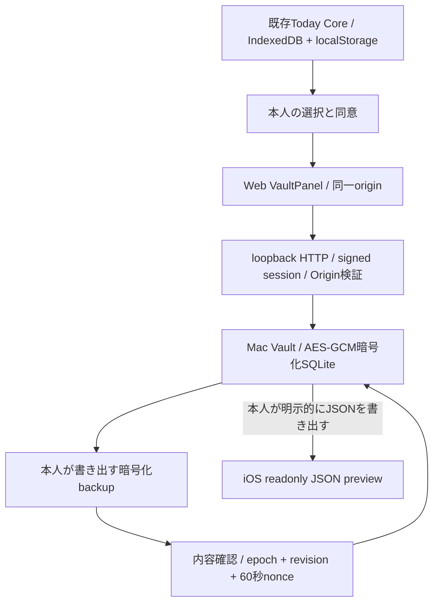

# V3 RC1 — 同じMacの暗号化保存庫

2026-10-14。実装: `server/v3/local-vault.mjs`、`vault-crypto.mjs`、`vault-http.mjs`、`src/v3/VaultPanel.tsx`、`shared/v3-portable.mjs`。[RC範囲](RC_SCOPE.md)、[認証Mock](GATEWAY_PROTOCOL.md)、[移行dry-run](V2_MIGRATION_REPORT.md)とは境界を分ける。

## 構成とデータの正本

- Coreは既存ブラウザの正本。保存庫は本人が共有したコピー。DBを直接読むモデル、OAuth、外部Gatewayはない。
- 選択snapshotは最大6項目、source captureから5分の照会期限。全タスク同期ではない。
- アーカイブはmanual/non-demoのtask/event、参照可能な関連Contextと訂正をreadonly保存する。最大500項目、250 Context、500訂正、2MiB。会話・provider/OAuth・設定・未確定操作を含めない。
- V2に存在しないper-item revisionはnull。元の終日floating暦日はunknown_v2。推測で補完しない。元record JSONを保持するが、Core restore-readyはfalse。Contextの完全なDomain適合性検証・自動Core importは将来gate。
- iOSのJSONプレビューは明示書出しファイルだけを読む。現在live HTTPや暗号化backupをiPhoneへ自動転送しない。

## 暗号と認証の範囲

任意設定 `TODAY_V3_VAULT_DIR` が空なら機能は無効。初回setupには存在しない専用ディレクトリ、本人の明示同意、12〜256文字のパスフレーズが必要。既存DBの破損/欠落を空DBで置換しない。

PBKDF2-HMAC-SHA256 600,000回、random salt16bytes、derived key32bytes、AES-256-GCM random nonce12bytes/tag16bytes。AADはformat/vaultId/epoch/revisionのcanonical JSON。ディレクトリ0700・DB0600・同じOS所有者・symlink/hardlink拒否・SQLite schema/quick_check/inode確認。source本文とarchive/receiptは暗号化、salt/vault ID/epoch/revisionは平文metadata。SQLite file全体を暗号化する製品ではない。

[Node crypto](https://nodejs.org/download/release/v24.19.0/docs/api/crypto.html)、[OWASP password storage](https://cheatsheetseries.owasp.org/cheatsheets/Password_Storage_Cheat_Sheet.html)、[OWASP cryptographic storage](https://cheatsheetseries.owasp.org/cheatsheets/Cryptographic_Storage_Cheat_Sheet.html)を参照。これらは設計根拠であり、第三者の安全認証ではない。

鍵は解除したsigned browser sessionに結び、RAMのみ・15分で失効。明示lock/closeでもBufferをzero化し、確認intentを破棄する。JS文字列・復号後object・OS swapの物理消去は保証しない。Keychain、Ownerの既存秘密、パスワード抽出は使わない。失敗含めKDFはprocess全体で5回/分、busyは即拒否。

全APIは127.0.0.1固定Host、署名済みsession、X-Today-Request、Origin/Sec-Fetch-Site、JSON MIME、厳密なbody/queryとサイズ上限。no-store。Service Worker cacheへ入れない。同じOSアカウントの悪意あるprocess、XSS、盗まれたブラウザsession、全ディスクrollbackはこの認証だけで防げない。外部device identityやリモートOwner認証として扱わない。

## 原子性・復旧

- writer.sqliteのBEGIN IMMEDIATEで協調writerを排他。main DBはDELETE journal、synchronous FULL。main transactionが確定/rollbackするまでleaseを解放しない。
- 書込はepoch、expectedRevision、operationId、明示consentを要求。exact hash/receiptで再送を照合し、CASで競合を拒否する。receiptは128件上限で停止し、勝手に削除して重複効果を許さない。
- before-commit失敗はrollback。after-commit応答喪失はoutcome_unknownとして保存し、同じrequestのreceiptで照合する。未知の結果を成功/失敗のどちらかへ勝手に分類しない。
- 暗号化backupを本人が選択し、復号/契約確認→件数/期限/未解決暦日を表示→別の明示確認。60秒intentはsession/epoch/revision/one-useに結び、取消・lock・timeoutで無効化する。
- 復元は保存庫だけ。revisionはmax(現在,backup)+1、epochを変更。旧request/confirmationは再利用不可。旧source時刻を若返らせない。
- 再起動・復元後はsnapshotを再共有するまで照会不可。process中の時計後退も拒否し、Mac時刻を修正して再起動する。古いsourceを現在として返さない。
- 消去は別preview/confirm後に保存庫copiesを空へ原子的に更新しepoch変更。Core、download済みbackup、APFS snapshot、SSD物理領域を消す操作ではない。

未検証: setup中の電源断、物理停電/fsync故障、disk-full、SSD寿命、全ディスクrollback、別OS、実iPhone接続、第三者penetration test。SIGKILL試験は電源断保証ではない。passphraseを失った場合の復号回復機構はなく、暗号化backupも同じpassphraseが必要。単一writerの試験合格は自動multi-device sync成立を意味しない。

## AI・費用・利用手順

既存ChatModelPortのWeb Chatと承認付きCore操作を継承する。モデルにvault key/SQL/filesystem/API mutation権限を渡さない。Mac常駐Chat/ブラウザ閉鎖時のAI返信は未対応。

新依存・モデル・有料API・hosting・Developer Program契約を追加しない。Node/Xcode/Chrome/既存モデルcacheで試験する。CPU/メモリ/電力は使用する。新しい課金¥0。

READMEの同じMac起動例を使用し、**V3 日次サマリー実験 → Mac保存庫**でsetup。共有とアーカイブ保存は別同意。暗号化backupと「暗号化なし」のportable JSONを区別し、後者の保存場所・共有先は本人が判断する。試験環境には架空データだけを入れる。
