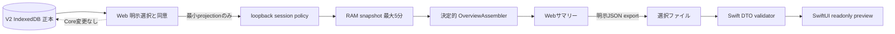

# DailyOverview v1 — ローカル実験契約

対象: `server/v3/overview.mjs`, `src/v3/contracts.ts`, `apps/ios/TodayNativeCore`。正式なremote/public APIではない。

## 実装したフロー

DBへの新write、provider取得、AI生成、MCP、remote sync、Messages送信はこのフローにない。

## APIとpolicy

| route                                      | 処理                                                                     |
| ------------------------------------------ | ------------------------------------------------------------------------ |
| `GET /api/v3/status`                       | enabledと契約名を返す。個人情報は返さない。既存cookieのbootstrapにも使用 |
| `POST /v3/workspace-snapshot`              | consent=true + 固定read scopes + bounded projectionをRAMへ登録           |
| `GET /v3/overview?date=YYYY-MM-DD&tz=IANA` | grantのある現在のsessionのselected projectionだけを整形                  |
| `DELETE /v3/workspace-snapshot`            | 現sessionのprojection/grantを失効・破棄                                  |

Webは同じpolicyの `/api/v3/...` aliasを使う。初期値は `TODAY_V3_OVERVIEW` 未設定=無効。

- 127.0.0.1/指定portのHostとtarget originだけ。CORSやLAN公開は追加しない。
- read/mutationは既存の署名cookieが必要。snapshotのないsessionは403。queryで別session、tenant、scopeを選べない。
- `X-Today-Request: 1` を要求する。POST/DELETEは厳密なOrigin、GETは同一Originまたはブラウザの `Sec-Fetch-Site: same-origin`。外部originのpreflightを許可しない。
- fixed scopes: `brief:read`, `tasks:read`, `agenda:read`。write scopes/余分な項目/順序差を拒否。
- max250件、入力65,536 bytes、max32session、publication12回/分、RAMのみ。期限後のreadを常に拒否。revoke/終了でgrantを破棄する。
- no-store / contract / request ID headers。エラーはcode、安全なmessage、requestId、retryable。タイトルや入力内容をエラーへ反映しない。
- 新規tasks/events/commands routeは実装しない。unknown V3 routeは405。無効時は404。

cookieは本人のアカウント・mobile端末を認証するものではない。同じsessionの別タブは同じgrantを使う。これをmulti-tenant securityの完成版とは呼ばない。

## 投影・DTO

- 非demo、activeの手動taskとmanual/google-calendar eventだけが候補。email、説明、original input、OAuth、会話履歴は対象外。
- UIは選択ゼロ件から開始し、共有同意もoff。選択だけで登録/生成しない。生成後に同意をリセット。
- upload時に選択対象を既存Coreから再取得する。missing/重複/250件超を拒否。V2の曖昧な終日eventは選択不可。
- task: id / title / sourceTime / dueAt / importance。サーバーでgroupとreasonを追加。
- event: id / title / sourceTime / source / allDay、instant開始終了またはfloating暦日開始終了（終了exclusive）。
- overview: schemaVersion=1、contractVersion=`today.overview.v1`、coverage=`selected_only`、date/timeZone/generatedAt/capturedAt/expiresAt/snapshotHash、sources、counts、summary/warnings/tasks/events。
- hashはprojectionのSHA-256であり、ファイルの出所・本人認証・真正性を証明しない。暗号署名ではない。
- tasksの期限groupは指定timezoneの暦日で決める。overdue→due_today→unscheduled→later、明示importance降順、due/idで安定ソート。
- eventは指定zoneの当日とoverlapするものを返す。midnight endは前日まで、DSTはIANA規則、allDayはfloating dateで評価。
- provider retrievedAtをupload時刻に置き換えない。readyなcalendarも5分以上古ければstale。partial/stale/disconnected/unconfigured/unavailableのcalendar件数はnull。
- 手動task/event件数はあくまで選択集合。calendar readyの件数もselected observedでありprovider全体ではない。mail/weatherはnull。欠損≠0。

## Nativeの読み込み

FileImporterで本人が選択したJSONを128KiBまで読む。DTO enum/schema/date/count/重複ID/期限を検証し、invalidはクリアしてエラー。expiredは読み込めても常に期限切れ表示。出所未検証表示を保つ。表示データの消去はRAMのみで元ファイルを消さない。アプリのDocumentsをFilesに公開するが、秘密情報・task正本を置かない。

## 次段階のgate

device pairing/session寿命/revoke・tenantとchannel scope・永続正本/単一writer・ETag/outbox・client generation・MCP認証を定めてからremote/native live APIを追加する。security negative tests/real device/fresh release qualificationが済むまでproduction/Publicリリースと扱わない。
