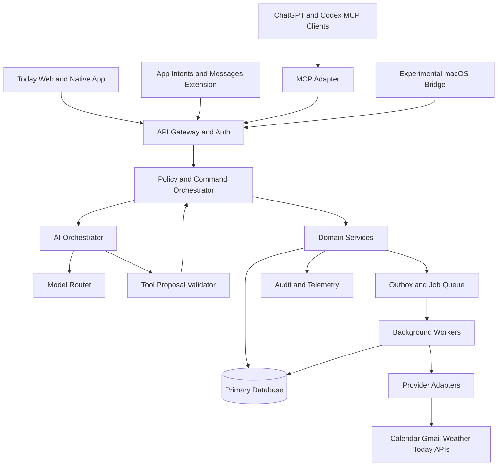

# Today V3 — Production Architecture & Delivery Specification

**Status:** Proposed architecture / implementation contract  
**Target baseline:** Today V2.1.0 (verify actual repository state before implementation)  
**Owner:** TacCityPark  
**Version:** Draft 1.0 — 2026-10-10  
**Scope:** Daily Hub + Today Intelligence + cross-channel access + Messages + MCP + operations

> This document is a target-state engineering specification, not a claim that the described components already exist. All baseline assertions, Apple platform capabilities, plugin compatibility, and provider interfaces require repository inspection and official documentation validation before implementation.

## 0. Executive engineering decision

Today V3 is a **channel-independent personal intelligence platform**. It retains Today as the system of record for native tasks and user preferences, and adds a shared domain/application core accessed from Web, native iOS, Siri/App Intents, Messages extension, ChatGPT/Codex via MCP, and optional experimental macOS Message Bridge. No channel may bypass the authorization and command-execution layer. **The official Apple Messages extension is not equivalent to a general-purpose background iMessage bot**; automatic conversational iMessage operation must be isolated as an unsupported/experimental capability until verified.

### Non-negotiable invariants

1. Every external side effect is bound to an authenticated principal, tenant, scope, explicit action intent, and audit event.
2. AI output is untrusted proposal data; it never directly executes database writes or provider calls.
3. Reads distinguish source event time, retrieval time, and effective time. Missing data is never silently represented as zero.
4. Retries must not duplicate calendar events, tasks, messages, or notifications.
5. Data deletion, permission revocation, and account disconnect are supported as first-class workflows.
6. V2 remains functional during phased V3 rollout; all schema changes are backward-compatible until an explicit cutover.
7. Users can access essential tasks/calendar without depending on a remote LLM.

## 1. Product contract and scope

### 1.1 Primary jobs
- **Morning brief:** '今日どう？' returns agenda, overdue/due tasks, forecast and actionable alerts with source timestamps.
- **Conversational planning:** propose and, after authorization, create/update tasks and calendar entries.
- **Cross-channel continuity:** consistent identity and state across Today app, ChatGPT/Codex and supported Apple entry points; conversation history shared only with explicit consent and retention controls.
- **Proactive alerts:** scheduled deadline and weather-related checks with user-controlled frequency, quiet hours, and opt-out.
- **Explainability:** every recommendation cites the source records and freshness; uncertainty and missing provider data are explicit.

### 1.2 Out of scope for V3.0 GA
- Unattended automation of arbitrary personal iMessage conversations.
- Background reading of all iMessage conversations via unsupported APIs.
- Autonomous payments, purchases, account changes or message sending without confirmation.
- Universal cross-provider sync when providers lack supported APIs.
- Guaranteed zero-cost inference or guaranteed always-on availability on a sleeping Mac.

### 1.3 Release sequence
V3.0: Daily Hub, stable domain APIs, permissions, MCP read-only and approved write actions, observability.  
V3.1: Native iOS App Intents, supported Messages extension, improved offline behavior.  
V3.x experimental: separately gated macOS bridge feasibility, with explicit user opt-in and no GA dependency.

## 2. Reference architecture



### 2.1 Bounded contexts
- **Identity & Consent:** account, session, OAuth linkage, device registration, permissions, consent ledger.
- **Agenda:** normalized event snapshots, timezone-aware schedule, calendar sync cursors.
- **Tasks:** task lifecycle, priority, due dates, provenance, external linkage.
- **Briefing:** snapshot assembly, ranking, explanation and cache.
- **Intelligence:** model routing, context budgeting, structured tool proposals, evaluation.
- **Notifications:** scheduling, quiet hours, deduplication, channel dispatch.
- **Integrations:** provider-specific OAuth, API quota and error handling.
- **Conversation:** session boundaries, channel metadata, consent-based retention and deletion.

**Architecture rule:** adapters cannot access another context's tables directly; use application interfaces/events. Avoid premature microservices: begin as a modular monolith plus isolated workers and MCP transport.

## 3. Identity, security and trust boundaries

### 3.1 Authorization
- Use OAuth 2.0 Authorization Code + PKCE for supported user-facing integrations; validate issuer, audience, nonce/state, redirect URIs and token lifetime.
- Each request carries `subject_id`, `tenant_id`, `client_id`, `channel`, `scopes`, `session_id`, `request_id`.
- Enforce policy server-side at every tool and domain command, not in prompts or UI only.
- Define fine-grained permissions: `agenda:read`, `agenda:write`, `tasks:read`, `tasks:write`, `brief:read`, `mail:summary:read`, `notifications:manage`.
- Sensitive mutations require explicit confirmation tokens bound to action digest, subject, target, expiry and one-time nonce.
- Treat user messages, mail bodies, calendar descriptions, webpages, and tool results as untrusted content; no instruction precedence over developer/system policy.

### 3.2 Data protection
- Encrypt in transit (TLS) and at rest; encrypt OAuth refresh tokens with envelope encryption and managed key rotation where available.
- Store secrets outside source control; redact tokens, email contents and personal data from logs/traces.
- Retention policy per category; account export and deletion; revoke provider tokens on disconnect where supported.
- Default off: training on personal data, third-party telemetry containing content, cross-channel conversation sharing.
- Add CSRF protections for cookie sessions; rate limits and abuse controls by principal/client; CSP and strict origins for embedded UIs.
- Build a threat model covering prompt injection, confused deputy, cross-tenant access, SSRF, webhook spoofing, replay, token leakage and provider impersonation.

### 3.3 Risk-tiered commands
| Tier | Examples | Execution policy |
|---|---|---|
| R0 | Read calendar, read tasks, fetch forecast | Authorized read; no confirmation |
| R1 | Create private task, mark task complete | Authorized write; reversible or confirmed depending on context |
| R2 | Edit external calendar, send notifications to others | Explicit per-action confirmation; audit |
| R3 | Delete bulk records, send external messages, change linked accounts | Strong confirmation; extra verification and rollback plan where feasible |

## 4. Canonical data contracts

All domain entities have stable UUID/ULID IDs, `tenant_id`, `created_at`, `updated_at`, `version`, `source`, `source_id`, `retrieved_at` and `deleted_at` where appropriate. Times are stored as UTC instants with original IANA timezone where user intent requires it. Use optimistic concurrency (`version` or ETag).

### 4.1 Core entities
- `User`, `Identity`, `Device`, `ConsentGrant`, `ProviderConnection`
- `Task(id,title,status,priority,due_at,timezone,source,external_ref,version)`
- `Event(id,provider,external_id,start_at,end_at,timezone,all_day,etag,last_synced_at)`
- `Brief(id,date,timezone,snapshot_hash,generated_at,source_watermarks,sections)`
- `AlertRule(id,trigger,quiet_hours,channel,enabled,last_evaluated_at)`
- `Conversation(id,channel,retention_policy,consent_version)`
- `Command(id,actor,action,resource,arguments_hash,idempotency_key,status,confirmation_id)`
- `AuditEvent(id,actor,action,resource,result,trace_id,occurred_at)`

### 4.2 Consistency rules
- Provider snapshots are not authoritative for local task state; external events retain provider IDs and ETags.
- Provider writes use idempotency keys, deduplication ledger and read-after-write verification when APIs permit.
- Store a durable outbox entry in the same transaction as local state changes; workers retry with exponential backoff and jitter; poison jobs enter a dead-letter queue.
- Conflict policy: never silently overwrite user changes. For external calendar conflicts, refetch and present conflict resolution.
- Offline changes queue locally with client-generated operation IDs; reconcile deterministically when connected.

## 5. Public API and MCP contracts

### 5.1 HTTP API (illustrative, subject to repo conventions)
```
GET    /v3/overview?date=YYYY-MM-DD&tz=Asia/Tokyo
GET    /v3/tasks?status=open
POST   /v3/tasks
PATCH  /v3/tasks/{id}                # If-Match required
GET    /v3/events?from=...&to=...
POST   /v3/commands/preview          # validate and return diff, risk, expiry
POST   /v3/commands/{id}/confirm     # one-time confirmation
GET    /v3/commands/{id}             # outcome and reconciliation status
GET    /v3/connections
DELETE /v3/connections/{id}
GET    /v3/privacy/export
POST   /v3/privacy/delete-request
```
Error envelope: `code`, `message`, `request_id`, `retryable`, `details` (safe for display). Cursor pagination, rate-limit headers, contract version and trace propagation are mandatory.

### 5.2 MCP tools
Read-only: `today_get_overview`, `today_list_tasks`, `today_list_events`, `today_get_brief`, `today_get_connection_status`.  
Mutation: `today_preview_command`, `today_confirm_command`, `today_get_command_status`.  
Never expose arbitrary SQL, shell execution or unconstrained network fetch through MCP. Tools return structured data, source timestamps and human-readable summaries. Authenticate each MCP client and validate its capabilities; no implicit trust based on client identity.

### 5.3 Example preview response
```json
{
  "command_id": "cmd_01...",
  "status": "requires_confirmation",
  "risk": "R2",
  "proposed_action": "calendar.create_event",
  "preview": {"title": "打ち合わせ", "start_at": "2026-10-12T10:00:00+09:00"},
  "expires_at": "2026-10-10T14:00:00Z",
  "idempotency_key": "client-generated-unique-key",
  "source": "user_request"
}
```
Confirmation must recheck permissions, provider connection and event conflicts; a stale preview cannot be executed blindly.

## 6. Intelligence architecture

### 6.1 Pipeline
`Intent classification → context retrieval → evidence normalization → policy check → structured proposal → deterministic validation → user confirmation (if needed) → command execution → verification → audit`.

### 6.2 Model routing
- Rules-first for dates, permissions, recurrence, deduplication and critical operations.
- Local model optional for low-risk classification and summarization only after benchmark qualification.
- Cloud model optional for complex synthesis, subject to user consent and data-minimization.
- Fallback path provides deterministic daily overview when all model providers fail.
- No model is promoted based on perceived quality alone: require measured extraction, temporal reasoning, false-merge, tool selection and adversarial test results.

### 6.3 Context Engine 3
Evidence objects: `fact`, `source_ref`, `source_time`, `retrieved_at`, `confidence`, `permission_scope`, `expires_at`, `contradiction_group`. Separate confirmed facts from hypotheses and recommendations. Never present stale forecast or incomplete mailbox sync as current. Rank tasks using due date, explicit user priority, urgency and calendar constraints; display the reason, allow overrides, and avoid opaque behavioral profiling.

## 7. Daily Hub engine

`OverviewAssembler` queries task/calendar/provider snapshots concurrently with bounded timeouts and circuit breakers; returns partial results plus per-provider status. `BriefingComposer` creates deterministic sections first, then optional AI narrative. `SuggestionEngine` emits recommendations with evidence and confidence; it does not mutate state.

### Briefing output
- Date and timezone; generated time and provider freshness.
- Today's agenda; overlapping events and travel buffer only if grounded in user preference/route data.
- Due and overdue tasks; explicit priority rationale.
- Weather with forecast source and update timestamp.
- Important email summary only when consented and connected.
- Missing-source warnings and retry controls.

## 8. Apple Messages and native integration

### 8.1 Supported primary path
Implement an iOS native Today client with **App Intents / Shortcuts** for quick actions and a **Messages app extension** for user-initiated access and content sharing where supported. Confirm actual extension interaction, lifecycle, deployment target and review requirements against current Apple documentation. Do not promise background access to arbitrary messages or unattended bot replies.

### 8.2 Experimental macOS bridge
Separate executable, local-only by default, disabled by default, never a dependency for GA. Investigate documented APIs first; unsupported UI scripting is brittle and must not be marketed as official iMessage integration. Require opt-in, device-level permissions, per-conversation allowlist, visible execution status, rate limits and emergency stop. Never silently ingest third-party conversations. Do not implement a mass-messaging mechanism.

### 8.3 Always-available semantics
Define separately: (a) user can invoke Today from supported UI entry points; (b) server can answer while hosted infrastructure is online; (c) native device can provide limited offline data. Do not equate these with a permanently active iMessage bot. Document service availability, offline behavior, background execution limitations and push delivery constraints.

## 9. Reliability and performance SLOs (proposed targets)

| Indicator | Initial target | Measurement |
|---|---:|---|
| Overview API availability | ≥99.9% monthly | synthetic + server telemetry |
| Cached overview p95 | ≤500 ms | server-side latency |
| Fresh multi-provider overview p95 | ≤3 s excluding slow providers | distributed traces |
| Command duplicate side effects | 0 in release qualification | replay tests |
| Unauthorized cross-tenant reads | 0 | security tests |
| Critical command audit coverage | 100% | event-to-audit reconciliation |
| Local deterministic brief under model outage | 100% for available local data | chaos tests |
| Crash-free native sessions | ≥99.5% | privacy-safe crash reporting |

These are design targets, not measured V2 or V3 performance. Define service-level indicators and load profiles before enforcing thresholds.

## 10. Test and evaluation strategy

- **Unit:** date/time DST boundaries, recurrence, prioritization, schema validation, permission policies.
- **Contract:** OpenAPI/MCP schema snapshots; provider mock fixtures; backward compatibility.
- **Integration:** OAuth renewal/revocation, outbox retries, ETag conflicts, provider partial outages, rate limiting.
- **End-to-end:** overview → preview → confirmation → provider write → verification → audit.
- **Adversarial:** prompt injection in calendar/email, cross-user data access, replay, webhook forgery, SSRF, token leakage, malformed model JSON.
- **Model evaluation:** blind holdout sets; false-merge and false-action rates, temporal extraction, refusal correctness, citation grounding, Japanese language accuracy.
- **Recovery:** backup restoration, schema downgrade strategy, disconnected mode, failed queue replay, notification deduplication.
- **Apple-specific:** real-device extension lifecycle, lock-screen behavior, permissions, background constraints, App Store compliance.

Release blockers: any reproducible unauthorized access; unconfirmed high-risk write; duplicate external side effects; unbounded secret exposure; data loss; unsupported Apple feature presented as supported.

## 11. Observability and operations

Use OpenTelemetry traces/metrics with privacy-safe correlation IDs; dashboards for API error rate, p95/p99 latency, provider failures, queue age, retry count, command confirmation outcomes, token refresh errors, cost per active user and model fallback. Log no message bodies or secrets by default. Establish incident severity levels, on-call/runbooks, backup encryption, tested restore objectives, feature flags and emergency disable switches per provider/channel/model.

## 12. Deployment and migration

1. **Baseline audit:** inspect V2.1.0 repository, tests, schemas, release assets and actual provider integrations. Record facts and unknowns; no assumptions.
2. **Architecture decision records:** approve domain boundaries, database, auth model, MCP transport, native platform strategy.
3. **Expand schema:** additive migrations, dual-read compatibility, backfill with checkpoints and validation.
4. **Shadow mode:** generate V3 overviews without exposing or executing new writes; compare with V2 data.
5. **Canary:** internal accounts, then limited users; monitor error budgets and data consistency.
6. **Cutover:** gated by contract, security, load and recovery tests; preserve rollback feature flags.
7. **Cleanup:** remove V2 paths only after stable usage and verified migration; publish migration notes.

## 13. Repository layout (target, adapt to existing conventions)

```
apps/web/
apps/ios/
apps/mcp-server/
services/api/
services/workers/
packages/domain/
packages/application/
packages/provider-adapters/
packages/intelligence/
packages/policy/
packages/contracts/
packages/observability/
infra/
docs/adr/
docs/security/
tests/contract/
tests/e2e/
tests/adversarial/
```

Prefer one coherent dependency graph over duplicating task and event logic across app, MCP and iOS layers. Generate clients from versioned contracts where practical.

## 14. Engineering work packages and exit gates

**WP0 Repository audit:** dependency map, database migrations, test coverage, actual model behavior, existing API routes, threat inventory. Gate: evidence-linked inventory approved.

**WP1 Domain contracts:** shared entities, typed DTOs, versioned APIs, time/provenance semantics. Gate: contract tests green.

**WP2 Identity & policy:** scoped tokens, confirmation service, consent ledger, tenant isolation. Gate: negative authorization suite green.

**WP3 Daily Hub:** deterministic overview, partial-provider results, evidence-aware suggestions. Gate: timezone/failure test matrix green.

**WP4 Intelligence:** tool proposal validation, routing, model eval and fallbacks. Gate: holdout thresholds defined and met; no false external actions.

**WP5 MCP:** authenticated read tools then confirmation-gated mutations. Gate: two supported client integrations verified independently.

**WP6 Native Apple:** App Intents, extension, offline cache and permissions. Gate: tested on physical devices; capabilities accurately documented.

**WP7 Operations:** telemetry, restore drill, rate limiting, cost controls, runbooks. Gate: recovery and security exercises passed.

**WP8 Release:** documentation, accessibility, localization, licensing, privacy disclosures and rollout. Gate: signed release checklist, rollback tested.

## 15. Codex execution contract

Codex must begin in **read-only audit mode**. It must not edit files, install dependencies, change secrets, push commits, or alter production services before presenting: (1) verified current-state map with file paths; (2) gap analysis against this specification; (3) ADR options/tradeoffs; (4) ordered implementation PR plan; (5) risk and migration plan; (6) test evidence and acceptance gates. Distinguish *observed*, *inferred*, and *proposed* facts. After approval, implement one vertical slice at a time, with tests, documentation and rollback notes in each PR. Avoid blanket rewrites, hidden mocks in production and fabricated passing benchmarks.

### First vertical slice (recommended)
Authenticated `GET /v3/overview` with local tasks and connected calendar snapshots, provider freshness flags, deterministic summary, contract tests and no new write paths. This establishes the architecture without putting user data at risk.

## 16. Open decisions requiring verification

- Does the current V2.1.0 repository contain native iOS code or only web components?
- Which storage and session models are already deployed?
- Which providers are real, mocked, or partially functional?
- What exactly is the existing AI Chat protocol and its failure behavior?
- What MCP/plugin packaging formats and supported client surfaces are currently documented?
- Which Apple Messages extension actions are permitted for the minimum deployment target?
- What hosting budget, supported user count, retention requirements and privacy policy apply?
- Is Today to be fully open-source, partially open-source, or open-core?

**Approval condition:** no implementation choice is considered final until the repository baseline and current official platform documentation are verified.
