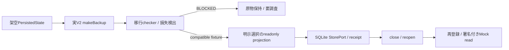

# V3 alpha.3 — V2 backup互換性 / 移行dry-run

> RC1の現在の実装・検証は [実装記録](IMPLEMENTATION_STATUS.md) と [Mac保存庫](LOCAL_VAULT.md) を参照。以下はalpha基盤の範囲・履歴で、local vaultの試験結果とは区別する。

2026-10-11。`src/v3/fixture-migration.ts` は純粋なread-only checker。実IndexedDB/localStorageを開かず、source/stateに書き戻さない。明示opt-inとfixture IDを要求するが、IDだけで本文が架空だと自動証明できるものではない。harnessで作成した架空データのみ使用する。

## 実資料から確認したV2 exportの範囲

`src/backup.ts:makeBackup` はouter `app=Today, version=2, exportedAt` とstateを生成する。state version=2、manual/non-demo items、空queuedActions、theme、showSamples=false。実PersistedStateがversion=3でもexport schemaは2である。

このexportには、provider/OAuth state、Context/corrections、全queued operations、per-item target revision、Gatewayの操作receiptがない。**V2 exportだけから完全な正本・同期・権限・revisionを復元できない。** 新export/migration契約を別途設計する。Gateway envelope revisionをDomain item revisionに置き換えない。

## checkerの契約

- 上限2MiB/500件。JSON/schema、fictional IDs、source datesを先に検証する。
- `previewBackup` の既存normalizationと比較し、IDs、status、pinned/snooze、description、開始/終了/締切/source時刻を確認する。
- normalizerが欠損日時へ現在時刻を補う前に停止する。
- 重複ID、非manual/demo、pending operations、不明state/field、値のtruncation、action payload除去、逆転したevent範囲、future source、未対応revisionを検出する。
- 終日eventのUTC instantから元のfloating dateは推測しない。`ALL_DAY_FLOATING_DATE_UNRECOVERABLE` としてBLOCKEDにする。
- findingが一つでもあればcandidateState=null。元backupの**exact bytes**はsourceArchiveとして保持する。sourceの真正性や暗号化を保証するhashではない。
- findingがない場合も `DRY_RUN_COMPATIBLE` はV2 normalizationに対する架空dry-runだけ。実Gateway正本移行や実ユーザーへの同意が成立したという意味ではない。

対象はmanual exportの選択readonly replica。offset付き日時はsource archiveで原表記を保持するが、Gateway DTOのUTC日時契約へ全形式を変換できることは未証明。実移行ではinstantの正規化と暦日の区別が必要。

## 実行した統合フロー

7件のchecker negative/互換試験と、上記の1件の統合試験。統合では選択task ID/期限、source capture、revision、重複効果なし、非選択descriptionの非投影、元state/backup bytes不変を確認する。Gatewayはin-process Mock、実iPhone/TLSは未実施。実行結果は [実装記録](IMPLEMENTATION_STATUS.md)。

**M-01:** 初期比較がJSON objectのkey順だけを値の損失と誤判定した。`migration-order.before-fix.log` を保持し、object keyをcanonicalizeして比較する最小修正を行った。配列順と値の差は引き続き検出する。統合とnegative回帰で確認した。

統合harnessでoverview/tasks応答型を取り違えたfailureと、browser-oriented TS configにNode fixture import型がないfailureも保存。fixtureのoperationをtasksへ揃え、Node importsだけを明示的な型例外とした。製品configやgateを無効化していない。

## 次に必要なこと

1. source revision、終日floating date、削除/tombstone、Contextを保持するexport設計。
2. readonly replicaのselection/expiry/delete/permission取消連鎖。
3. shadow比較と復旧訓練。Gateway正本化は [ADR 004](../adr/004-fixture-sqlite-and-readonly-migration.md) の比較から再判断する。

実データ移行の準備完了はNO。公開V2.1.0のbackup behaviorは変更していない。
